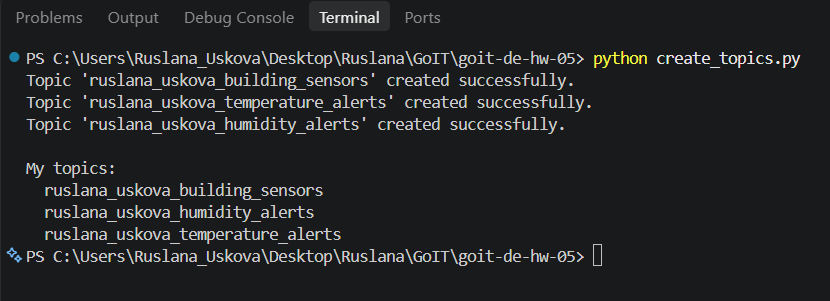
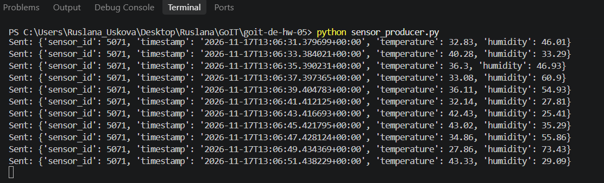
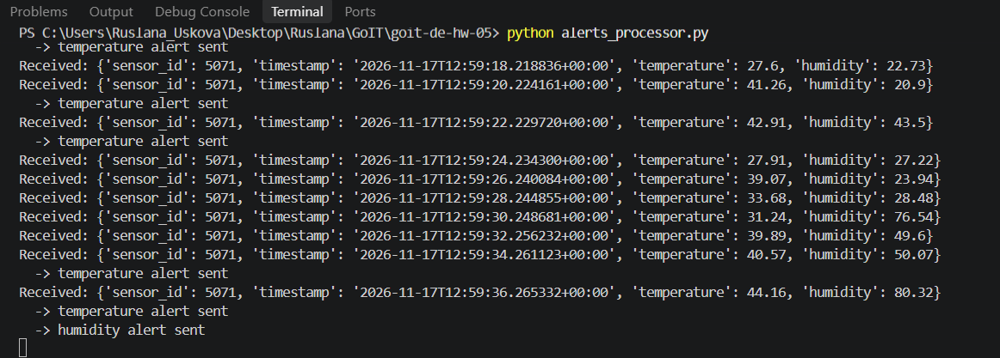
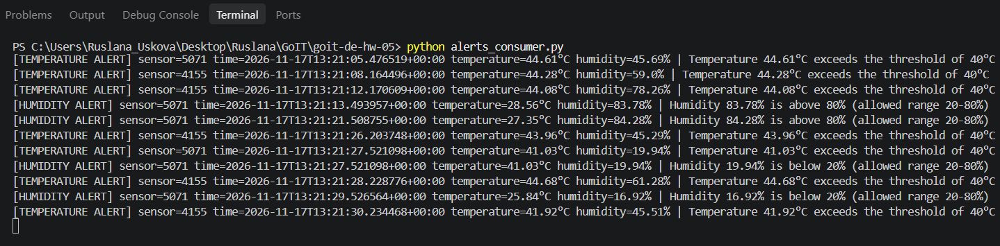

# goit-de-hw-05 — Моніторинг датчиків будівлі з Apache Kafka

Система збирає показники температури та вологості з IoT-датчиків, виявляє вихід значень за допустимі межі та розсилає сповіщення через Apache Kafka.

```
sensor_producer.py ──► building_sensors ──► alerts_processor.py ──┬──► temperature_alerts ──┐
 (N запусків = N датчиків)                                        └──► humidity_alerts ─────┴──► alerts_consumer.py
```

## Структура проєкту

| Файл | Призначення |
|---|---|
| [configs.py](configs.py) | Параметри підключення до Kafka, імена топіків, порогові значення |
| [serializers.py](serializers.py) | JSON- та string-серіалізатори для повідомлень |
| [create_topics.py](create_topics.py) | Крок 1 — створення топіків |
| [sensor_producer.py](sensor_producer.py) | Крок 2 — імітація датчика, відправка даних у `building_sensors` |
| [alerts_processor.py](alerts_processor.py) | Крок 3 — фільтрація даних, відправка сповіщень у `temperature_alerts` / `humidity_alerts` |
| [alerts_consumer.py](alerts_consumer.py) | Крок 4 — читання сповіщень і виведення на екран |
| [docker-compose.yml](docker-compose.yml) | Локальний брокер Kafka для тестування |

## 1. Створення топіків

Скрипт `create_topics.py` створює три топіки з префіксом `ruslana_uskova_`, щоб імена не дублювалися з топіками інших студентів:

- `ruslana_uskova_building_sensors` — дані з усіх датчиків;
- `ruslana_uskova_temperature_alerts` — сповіщення про перевищення температури;
- `ruslana_uskova_humidity_alerts` — сповіщення про вихід вологості за допустимі межі.



## 2. Відправка даних датчика

`sensor_producer.py` імітує роботу одного датчика: кожні 2 секунди надсилає в `building_sensors` повідомлення з полями:

| Поле | Значення |
|---|---|
| `sensor_id` | Випадкове число, стале протягом одного запуску скрипту |
| `timestamp` | Час отримання даних (UTC, ISO 8601) |
| `temperature` | Випадкове значення від 25 до 45 °C |
| `humidity` | Випадкове значення від 15 до 85 % |

Щоб імітувати кілька датчиків, скрипт запускається кілька разів в окремих терміналах — кожен запуск отримує власний ID.



## 3. Обробка даних

`alerts_processor.py` підписується на `building_sensors` і перевіряє кожне повідомлення:

- **температура > 40 °C** → сповіщення в `temperature_alerts`;
- **вологість > 80 % або < 20 %** → сповіщення в `humidity_alerts`.

Якщо порушено обидві умови, сповіщення надсилається в обидва топіки. Кожне сповіщення містить ID датчика, значення температури та вологості, час вимірювання, час генерації сповіщення та текстове повідомлення про перевищення порогу.



## 4. Отримання сповіщень

`alerts_consumer.py` підписується одночасно на `temperature_alerts` і `humidity_alerts` та виводить кожне сповіщення на екран із позначкою типу (`[TEMPERATURE ALERT]` / `[HUMIDITY ALERT]`).

На скриншоті одночасно працюють два датчики — **5071** і **4155** (два окремі запуски `sensor_producer.py`), і сповіщення від обох надходять в один консьюмер. Видно всі три типи порушень:

- температура вище 40 °C (наприклад, 44.61 °C);
- вологість вище 80 % (83.78 %);
- вологість нижче 20 % (16.92 %).

Показання датчика 5071 о `13:21:27` (41.03 °C, 19.94 %) порушують обидва пороги, тому для нього згенеровано два сповіщення — у кожен топік.



## Запуск

```bash
pip install -r requirements.txt

# локальний Kafka (необов'язково, якщо використовується віддалений кластер)
docker compose up -d

python create_topics.py
python alerts_processor.py     # термінал 1
python alerts_consumer.py      # термінал 2
python sensor_producer.py      # термінал 3, 4, ... — кожен запуск = окремий датчик
```

За замовчуванням скрипти підключаються до `localhost:9092`. Для віддаленого кластера з SASL-автентифікацією задайте змінні середовища (PowerShell):

```powershell
$env:KAFKA_BOOTSTRAP_SERVERS="host:9092"
$env:KAFKA_SECURITY_PROTOCOL="SASL_PLAINTEXT"
$env:KAFKA_USERNAME="..."
$env:KAFKA_PASSWORD="..."
```
